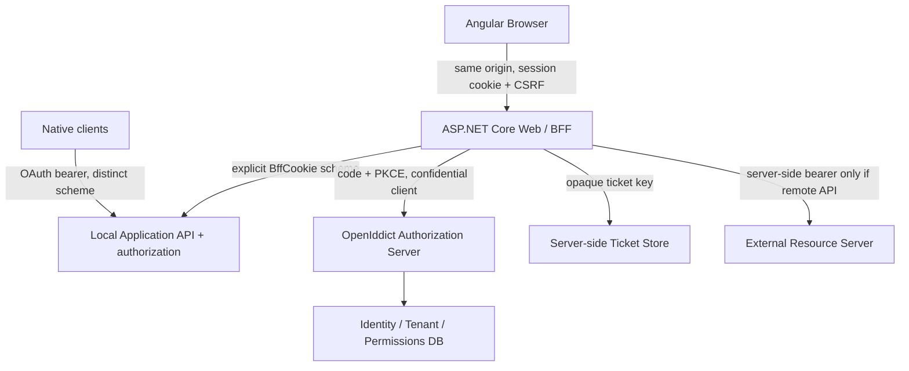

# BFF architecture — design specification (planned)

> **Status:** approved design, not implemented. [ADR](../decisions/ADR-0001-browser-bff.md).

## Boundaries

`Modules.System.Identity`: AS, users, credential verification, role/permission, tenant membership, authorization policies. `Modules.System.Bff`: OIDC client, browser login challenge/callback, cookie, ticket store adapter, anti-forgery, session endpoints, optional downstream tokens. `src/Web`: host composition and same-origin wiring. App `Domain/Application/Infrastructure` stays product-specific.

## Login flow

1. Browser navigates to `GET /bff/auth/login?returnUrl=/app`.
2. Validate a *relative local* return URL; reject open redirects. BFF issues OIDC challenge with PKCE, state, nonce, confidential client registration.
3. OpenIddict `/api/connect/authorize` validates client/redirect/scopes/PKCE. If no AS cookie, redirect to interactive login; credentials and CAPTCHA post to AS (not OAuth password grant).
4. AS creates its **own** cookie, issues one-time authorization code bound to correct account context and verified tenant.
5. BFF handles `/signin-oidc` callback, validates state/nonce/issuer/audience and exchanges code server-to-server.
6. BFF creates a *new* opaque session ID, stores protected ticket and tokens server-side, issues `__Host-Foundation.Bff` host-only cookie; redirects to validated relative return URL.
7. Angular requests `GET /bff/session` and initializes in-memory Signals. No JS OAuth token.

Important: use ASP.NET Core's OIDC middleware/registration where possible; do not manually implement state, nonce or token exchange cryptography.

## Request flow / route schemes

- Browser: same-origin `/bff/*` and applicable `/api/*` endpoints use **BffCookie** by explicit policy and CSRF validation for unsafe methods.
- Native/service: separately annotated endpoints use **OpenIddict bearer validation**; cookie credentials must not accidentally authorize these.
- API request without credentials returns **401 JSON**, not an HTML redirect. Insufficient permissions return **403**.
- Local APIs execute in-process under verified user/tenant context; never blindly proxy inbound Authorization headers or build open proxies.
- For remote resource APIs, BFF obtains token from protected store, refreshes under per-session concurrency control, forwards to an allowlisted destination. Never reflect tokens downstream to browser.

## Tenancy

- Host-only cookie: `Secure=true`, `HttpOnly=true`, `Path=/`, no Domain, name `__Host-Foundation.Bff`.
- Cookie `SameSite=Lax` default for browser session to keep navigation/redirect compatibility; adjust to Strict only with tested flows. OIDC transient correlation/nonce cookies follow middleware requirements.
- Request host is resolved only from trusted host/forwarded-host mappings behind configured trusted proxies.
- BFF ticket contains tenant context and account type. Verify host + ticket context on each protected request, including access changes; deny mismatches.
- For system admin and tenant host separation, a dedicated AS domain enables federated sign-in; never share BFF cookie across tenant subdomains.
- Every data operation still enforces backend authorization, query isolation **and** write validation.

## Session store and revocation

- `ITicketStore` with a random opaque session key; store protected ticket, minimal claims and encrypted token fields server-side.
- Multi-instance: Redis or SQL-backed shared store with expiration, revocation and protected key material, plus persisted shared ASP.NET Core Data Protection key ring. Treat storage outage as fail-closed.
- Idle timeout and absolute maximum lifetime enforced server-side. Regenerate session ID after login and any elevation.
- Revocation by session ID and all sessions for user; token revocation best-effort additionally. Revalidate user activity/security stamp and critical grants.
- Protect concurrent refresh by distributed per-session coordination; enforce refresh token rotation. Explicitly test restart/replay.

## CSRF / XSS

- `IAntiforgery`: browser reads only `XSRF-TOKEN` (not an OAuth token); sends `X-XSRF-TOKEN`; server validates header for unsafe operations, including logout.
- Check Origin/Referer and Fetch Metadata on unsafe requests where available. Never let unsafe actions use GET.
- CSP, XSS defenses, no unsafe inline scripts by default, no tokens/credentials in logs or exceptions.
- CORS disabled for standard same-origin calls; do not combine wildcard origins with credentials.

## Deployment options

- Default: Angular static files and `/api`, `/bff` under one public origin with same-host .NET API.
- Reverse proxy option: proxy only verified paths and trust explicit proxy networks (no forwarded-header trust from arbitrary clients).
- Local dev: HTTPS via secure localhost origin and dev certificate, or same-origin dev proxy; document exact host and ports.
- Multiple tenant custom domains: register exact OIDC callback URIs or use a stable login gateway/callback design before enabling dynamic domains.

## Open questions before production

1. Select durable ticket provider and deployment topology; Redis is optional for one node but not replaceable by per-node memory in a cluster.
2. Enforce safe environment/secret policy for AS signing, BFF client registration, Data Protection and logging.
3. Define session idle/absolute expiration and privileged reauthentication SLA.
4. Test OIDC remote callback, third-party cookie and custom-domain behavior across browsers.
