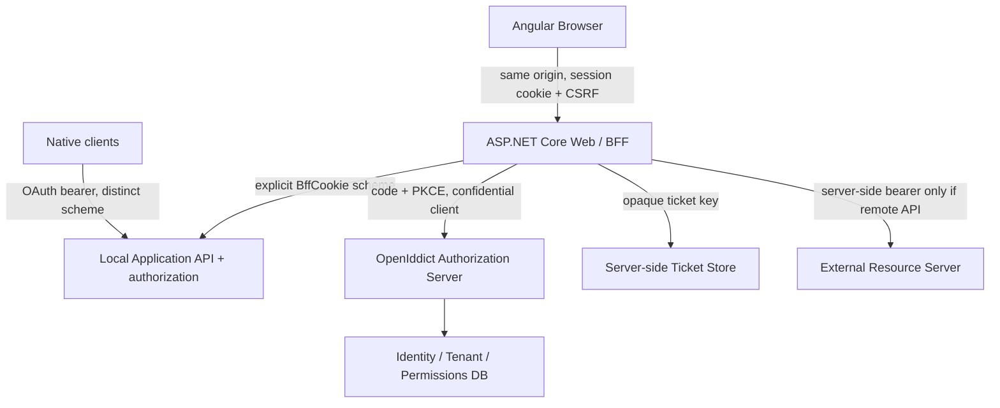

# BFF architecture — design and implementation status

> **Status:** Accepted target architecture; implementation is in progress. The full browser flow is **not yet operational**. [ADR](../decisions/ADR-0001-browser-bff.md).

## Delivery checkpoint — 2026-11-06

| Slice | Status | Evidence | Boundary |
| --- | --- | --- | --- |
| BFF-01 — server-side ticket store | Implemented, CI green | `Modules.System.Bff/DistributedBffTicketStore.cs`, PR #6 | The reusable store/cookie primitives exist; the BFF module is not composed into `Web`. |
| BFF-02 — Identity interactive session | Implemented, CI green | `IdentityServerCookieDefaults`, `IUserCredentialAuthenticator`, `Auth.cs`, PR #8 | Issues only the separate Identity Server cookie. It does not yet complete OpenIddict authorization or create a BFF session. |
| Authorization Code + PKCE | **Merged (PR #11)** | `Web/Endpoints/Connect.cs`, `IdentitySessionValidator`, BFF client seeder | Code+PKCE exchange and rejection tests green in isolated TestServer CI; does not yet supply browser BFF session. |
| BFF OIDC callback + session | Planned | Roadmap BFF-04 | Confidential client, callback validation, server-side token/ticket storage and BFF cookie are not wired. |
| Browser endpoints + Angular migration | Planned | Roadmap BFF-05/06 | No production browser BFF endpoints or Angular migration yet. |

The current implementation is deliberately split across two independent cookies:
- `__Host-Foundation.Identity`: Authorization Server's interactive user session, owned by `Modules.System.Identity`.
- `__Host-Foundation.Bff`: browser application session, owned by `Modules.System.Bff`; this is backed by the server-side ticket store and is **not issued yet**.

The legacy Password Grant remains enabled for existing consumers during migration. Do not infer that the new interactive endpoint is a completed BFF login flow.

## Boundaries

`Modules.System.Identity`: AS, users, credential verification, role/permission, tenant membership, authorization policies. `Modules.System.Bff`: OIDC client, browser login challenge/callback, cookie, ticket store adapter, anti-forgery, session endpoints, optional downstream tokens. `src/Web`: host composition and same-origin wiring. App `Domain/Application/Infrastructure` stays product-specific.

## Login flow

1. Browser navigates to `GET /bff/auth/login?returnUrl=/app`.
2. Validate a *relative local* return URL; reject open redirects. BFF issues OIDC challenge with PKCE, state, nonce, confidential client registration.
3. OpenIddict `/api/connect/authorize` validates client/redirect/scopes/PKCE. If no AS cookie, redirect to interactive login; credentials and CAPTCHA post to AS (not OAuth password grant).
4. AS creates its **own** cookie, issues one-time authorization code bound to correct account context and verified tenant.
5. BFF handles `/signin-oidc` callback, validates state/nonce/issuer/audience and exchanges code server-to-server.
6. BFF creates a *new* opaque session ID, stores protected ticket and tokens server-side, issues `__Host-Foundation.Bff` host-only cookie; redirects to validated relative return URL.
7. Angular requests `GET /bff/session` and initializes in-memory Signals. No JS OAuth token.

Important: use ASP.NET Core's OIDC middleware/registration where possible; do not manually implement state, nonce or token exchange cryptography.

## Request flow / route schemes

- Browser: same-origin `/bff/*` and applicable `/api/*` endpoints use **BffCookie** by explicit policy and CSRF validation for unsafe methods.
- Native/service: separately annotated endpoints use **OpenIddict bearer validation**; cookie credentials must not accidentally authorize these.
- API request without credentials returns **401 JSON**, not an HTML redirect. Insufficient permissions return **403**.
- Local APIs execute in-process under verified user/tenant context; never blindly proxy inbound Authorization headers or build open proxies.
- For remote resource APIs, BFF obtains token from protected store, refreshes under per-session concurrency control, forwards to an allowlisted destination. Never reflect tokens downstream to browser.

## Tenancy

- Host-only cookie: `Secure=true`, `HttpOnly=true`, `Path=/`, no Domain, name `__Host-Foundation.Bff`.
- Cookie `SameSite=Lax` default for browser session to keep navigation/redirect compatibility; adjust to Strict only with tested flows. OIDC transient correlation/nonce cookies follow middleware requirements.
- Request host is resolved only from trusted host/forwarded-host mappings behind configured trusted proxies.
- BFF ticket contains tenant context and account type. Verify host + ticket context on each protected request, including access changes; deny mismatches.
- For system admin and tenant host separation, a dedicated AS domain enables federated sign-in; never share BFF cookie across tenant subdomains.
- Every data operation still enforces backend authorization, query isolation **and** write validation.

## Session store and revocation

- `ITicketStore` with a random opaque session key; store protected ticket, minimal claims and encrypted token fields server-side.
- Multi-instance: Redis or SQL-backed shared store with expiration, revocation and protected key material, plus persisted shared ASP.NET Core Data Protection key ring. Treat storage outage as fail-closed.
- Idle timeout and absolute maximum lifetime enforced server-side. Regenerate session ID after login and any elevation.
- Revocation by session ID and all sessions for user; token revocation best-effort additionally. Revalidate user activity/security stamp and critical grants.
- Protect concurrent refresh by distributed per-session coordination; enforce refresh token rotation. Explicitly test restart/replay.

## CSRF / XSS

- `IAntiforgery`: browser reads only `XSRF-TOKEN` (not an OAuth token); sends `X-XSRF-TOKEN`; server validates header for unsafe operations, including logout.
- Check Origin/Referer and Fetch Metadata on unsafe requests where available. Never let unsafe actions use GET.
- CSP, XSS defenses, no unsafe inline scripts by default, no tokens/credentials in logs or exceptions.
- CORS disabled for standard same-origin calls; do not combine wildcard origins with credentials.

## Deployment options

- Default: Angular static files and `/api`, `/bff` under one public origin with same-host .NET API.
- Reverse proxy option: proxy only verified paths and trust explicit proxy networks (no forwarded-header trust from arbitrary clients).
- Local dev: HTTPS via secure localhost origin and dev certificate, or same-origin dev proxy; document exact host and ports.
- Multiple tenant custom domains: register exact OIDC callback URIs or use a stable login gateway/callback design before enabling dynamic domains.

## Open questions before production

1. Select durable ticket provider and deployment topology; Redis is optional for one node but not replaceable by per-node memory in a cluster.
2. Enforce safe environment/secret policy for AS signing, BFF client registration, Data Protection and logging.
3. Define session idle/absolute expiration and privileged reauthentication SLA.
4. Test OIDC remote callback, third-party cookie and custom-domain behavior across browsers.

## Next implementation issue

[BFF-04 — confidential OIDC callback and browser server-side session](https://github.com/sholehamed/foundation-backend/issues/12). BFF-03 Authorization Server flow merged in PR #11; full browser BFF remains unimplemented.

## Implemented Identity session slice (BFF-02)

The Identity module currently exposes the following endpoints under the configured backend prefix and System/Auth endpoint group:

- `GET /api/system/Auth/csrf`: creates the ASP.NET Core antiforgery cookie and exposes the request token in the JavaScript-readable `XSRF-TOKEN` cookie. Unsafe login requests send it in `X-XSRF-TOKEN`.
- `POST /api/system/Auth/interactive-login`: validates antiforgery token and CAPTCHA, authenticates either a System account or a Tenant account, then issues only `__Host-Foundation.Identity`. It returns no OAuth tokens.
- Existing `POST /api/system/Auth/login`: token endpoint passthrough for the legacy Password and Refresh Token grants; credential checks now use the same `IUserCredentialAuthenticator`.

Identity cookie settings: HttpOnly, Secure, host-only (`__Host-` prefix), Path=/, SameSite=Lax, 8-hour ticket lifetime with sliding expiration. Login endpoint has an IP-partitioned fixed-window limit of 20 requests/minute. The ASP.NET antiforgery cookie is also HttpOnly/Secure/host-only; only the request token is exposed to Angular.

### Important current limitations

- The OpenIddict authorization endpoint is configured for Authorization Code + PKCE but its passthrough handler does not yet authenticate this cookie or issue a code from it.
- The BFF OIDC client, callback, server-side BFF ticket registration in the Web host, BFF session/logout endpoints and Angular migration are not implemented.
- The Identity cookie is not yet a production-ready authorization session: user/security-stamp/role/tenant revocation revalidation must be integrated into the authorization endpoint before it is trusted for code issuance.
- System-account role/permission scope must be explicitly tested against the master system scope before the authorization endpoint is enabled. The current authenticator preserves the legacy system-account claim query; do not treat its role claims as the final authorization source.
- HTTPS is required for the `__Host-` cookies. Local HTTP development must use the documented HTTPS origin/proxy; do not weaken Secure cookie policy to make HTTP appear to work.

## Implementation rule

Every implementation slice updates this page, [project state](../PROJECT-STATE.md), [roadmap](../PROJECT-ROADMAP.md), the relevant module README and HTTP contract. A design item is not marked implemented until code, automated tests, integration evidence and documentation agree.

## BFF-03 completed Authorization Server architecture notes

The Authorization Server remains `Modules.System.Identity`; a dedicated `Connect` endpoint maps `GET/POST /api/connect/authorize` and calls `AuthenticateAsync(IdentityServerCookieDefaults.AuthenticationScheme)` explicitly. The principal is reconstructed from current database grants by `IdentitySessionValidator` and `IdentityPrincipalFactory` using strict System vs Tenant assignment scopes. The OpenIddict middleware is responsible for cryptographic protocol validation and one-time authorization code issuance; handler code never creates its own code or token.

The first-party BFF client is an optional confidential app, configured under `Identity:Bff:*`, with exact callback URLs. Any existing registered client is validated rather than silently reconfigured. `Identity:Bff:Enabled` is false by default. The authorization endpoint restricts implicit-consent issuance to the configured BFF client.

This **does not yet complete browser login**: the current Angular sign-in component expects the legacy token response and does not preserve an `/api/connect/authorize` returnUrl. Treat this as a named integration blocker, not as a reason to relax returnUrl checks or deliver tokens to JavaScript.

See [BFF-03 implementation notes](../development/BFF-03-IMPLEMENTATION.md) for exact code map, outstanding verification and next steps.
