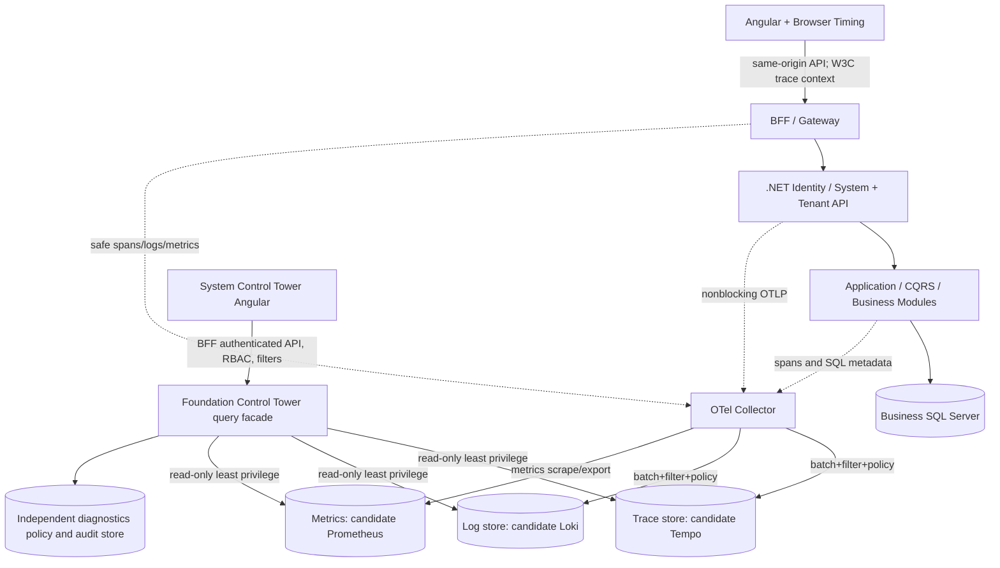

# FR-18A — Foundation Control Tower: reference architecture

**Date:** 2026-11-11  
**Status:** Architecture/design approved direction; **NOT IMPLEMENTED**. This file specifies target behavior and engineering contracts, not deployed endpoints.  
**Platform:** .NET 10, ASP.NET Core + OpenIddict/BFF, multi-tenant Foundation modules, EF Core/Dapper/ADO.NET, SQL Server, Angular System Admin.  
**Authority:** [ADR-0003](../decisions/ADR-0003-control-tower-observability-isolation.md) · [Telemetry contracts](../reference/control-tower-telemetry-contracts.md) · [Delivery and acceptance](../development/FR-18-CONTROL-TOWER-ROADMAP.md).

## 1. Objectives / non-goals

The operating question is: **for a particular authenticated request, show the execution's entry/exit and elapsed time, correlated application boundaries and dependencies, recorded SQL commands/transactions and relevant safe inputs/outputs, errors, retries and actual context, with an authoritative trace lineage**.

Primary personas:
- System Observer: performance metrics, sanitized traces/logs, error clusters and health, subject to centrally delegated read permissions.
- System Diagnostic Operator: time-bounded additional sanitized details with audited reason and approvals.
- System Diagnostic Administrator: register/approve source-declared capture policies, retention/budgets and incident session control.
- Security Auditor: immutable who-viewed-which-diagnostic/capture-policy history; does not get unconditional raw secrets.
- Tenant Owner: **no cross-tenant Control Tower**; optional future limited tenant-scoped read projection is separately reviewed. Tenant Owner cannot define System resources or menus.

Not goals at design approval: general-purpose code profiler attached to every method, query editor, production SQL execution console, capturing all request bodies, production-ready APM platform, data warehouse, remote desktop, payment proof, automated incident remediation or no-sample lossless history.

## 2. Current verified Foundation seams (not new implementation)

- Host bootstrap in `src/Web/Program.cs` delegates `RegisterServices()` and `RegisterApps()` to `src/Web/DependencyInjections.cs`.
- `src/modules/Modules.System.Identity/DependencyInjections.cs` owns OpenIddict authentication, Tenant context resolution, endpoint/permission policies, Identity data, BFF identity validation. Existing BFF authentication/session, CSRF and Cookie bridge semantics **must remain unchanged**.
- Separate reusable modules exist under `src/modules/`; app business modules can keep their own DbContexts. `IdentityDbContext` holds authoritative Tenant, permissions, plans and commercial control-plane state.
- `src/Web/DependencyInjections.cs` applies forwarded headers, CORS, media storage, BFF Tenant bridge, Identity pipeline and BFF endpoints in a security-sensitive order. New instrumentation must be placed deliberately without changing Tenant/auth/CSRF order or trusted proxy configuration.
- Existing `ILogger` calls, health checks and SQL auditing may exist; repo inspection did not find an OpenTelemetry SDK or `ActivitySource` integration before FR-18. Do not claim request/SQL spans already ship.
- System routes and central grants are sourced from code-owned Feature Registry and evaluated by backend + Angular guards. Only System Admin can define central menu/permissions; no default Tenant diagnostic grants.
- Docs, ephemeral CI staging and actual live deployment are separate; green CI never certifies production release.

## 3. Topology and data movement

**Deployment boundary:**
- **Production:** telemetry Collector/backend storage and read API capacity independent from the business SQL instance. Prefer separate compute/volumes/object storage; never share raw telemetry writes with `IdentityDbContext`.
- **Development:** Docker Compose may colocate isolated containers but not logical write paths; local transient telemetry is disposable.
- **Staging:** include SQL Server, backend, frontend, Collector and telemetry stores; validate two Tenant scopes and simulated Collector outage. Staging in Actions is ephemeral; hosted Staging requires a distinct operator-controlled approval.
- **Frontends:** no browser-to-Collector untrusted public ingestion of secrets by default. Browser spans and JS errors flow through a bounded/sanitizing same-origin telemetry ingestion API/proxy with origin/session checks, CSRF/rate limits and clear consent/scope; do **not** expose an open public OTLP receiver. No tokens or raw storage query endpoints in client.

## 4. Instrumentation coverage and source ownership

| Layer | Instrumentation | Safe signal / limitations |
| --- | --- | --- |
| ASP.NET Core inbound HTTP | OpenTelemetry ASP.NET Core instrumentation | Request route template, method, status, duration, trace context; avoid URL query/path PII and raw headers |
| BFF/OIDC | host-owned selected Activities and redacted events | Auth code flow boundary, session check outcome, refresh/CSRF errors; **no tokens, cookies, codes, nonces** |
| Tenant resolution | trusted middleware event after auth/resolution | Authenticated TenantId as restricted attribute; do not trust Host without existing resolver; no tenant in metric labels |
| Permission/entitlement | existing evaluator wrappers | Policy/source key, allow/deny, safe reason code; no full effective-grant or secret snapshot |
| CQRS | common pipeline behavior / `ActivitySource` | Stable command/handler class name, success/failure, elapsed, optional approved DTO shape; not every CLR method automatically |
| Domain services | explicitly code-owned ActivitySource + decorators | Named spans for important business steps, attributes with declared classification, no AOP indiscriminately |
| EF Core | `DbCommandInterceptor` or Diagnostics instrumentation | Command timings, Database, command type, success/failure, bounded normalized SQL fingerprint; ensure no duplicate spans |
| SqlClient/Dapper | SqlClient instrumentation or shared query wrapper | Duration/query fingerprint and source parent Activity; Dapper is ADO.NET, not a separate guaranteed auto-instrumented event |
| SQL transaction | limited and tested connection/transaction hooks | begin/commit/rollback state and duration; no write to telemetry within active business transaction |
| HTTP client | `HttpClient` instrumentation | sanitized destination/service ID, status, error, retry; redact URL query and outbound Authorization |
| Background jobs | explicit `ActivitySource`, message propagation | New trace and Span Links if asynchronous rather than claiming a synchronous parent; job duration, retries, fail |
| Cache / queue | instrument only actual configured provider | hit/miss/retry, queue age; exclude cache keys/payloads from telemetry |
| Runtime | `Meter`, .NET runtime instrumentation, infrastructure exporters | CPU, GC, memory, thread pool, pool saturation, health/readiness, drop counts and exporter overhead |
| Angular | routed view/HTTP timings + JS error handler | session-safe correlation, route templates, navigation metrics; no form values or JS access tokens |

**SQL capture boundary:** per-request SQL commands in a Trace are execution-level facts only when seen by the in-process command hook. `Query Store` provides aggregated historical query texts/plans/runtime/waits and may be correlated by normalized fingerprint and time window, **not claimed to be the execution plan of this exact HTTP request**. Advanced per-execution diagnostics via SQL Server Extended Events require DBA-review, short sessions and very limited scope/volume. No SELECT of arbitrary SQL from the Control Tower UI.

**Method input/output:** typed explicit DiagnosticFields providers for reviewed DTO properties. Endpoints/handlers with no provider show `not_collected`; avoid generic `JsonSerializer.Serialize(object)` / reflection capture of entire graphs. Body metadata length may be recorded separately.

## 5. Trace correlation and causality

- Use W3C Trace Context `traceparent` and `tracestate` according to official semantic conventions. .NET `Activity.Current.TraceId` is the server-side correlation source; inject/extract across internal HTTP dependencies and messages. Response `trace-id` exposure, if implemented, is an opaque support reference only, with no privileged metadata returned to the caller.
- Validate inbound context lengths/formats; baggage is *not authenticated*. Drop or allowlist baggage keys and values. Never accept `tenant.id`, `user.id`, `role`, `is_admin`, `diagnostic.session` as authority from tracing headers or browser.
- On successful authentication, scoped identity is derived from existing live BFF/OpenIddict/Tenant resolution and may enrich a **restricted internal** span. System queries determine allowed Tenant scope *before* reading traces; not from raw client-provided trace tags. TenantId is never a public Prometheus metric dimension; enforce cardinality control on labels.
- Error logs should carry `trace_id`, `span_id`, service name, environment and consistent `error.code`. External correlation headers never leak authentication claims or raw exception details.
- Sampled-out/unavailable trace is a legitimate outcome: return `trace_not_retained` / `telemetry_unavailable`, not fake empty detail.
- Span timing uses monotonic elapsed measurements; UTC timestamps are for locating records only. Async overlapping spans may sum to more than parent wall time; calculate self-time through interval union/subtract, not naive subtraction.

## 6. Request and response capture policy

Three collection profiles with independent budgets:
- **Standard:** always-on bounded RED metrics, selected low-cardinality logs/spans, HTTP metadata and sanitized failure codes. **Bodies/SQL raw parameters off**.
- **Detailed:** sanitized route-defined DTO fields, SQL normalized template (if approved), limited error details, authorized elevated sample ratio. Bound by method, content type, endpoint key and payload/attribute limits.
- **Diagnostic Session:** explicitly granted, two-person review if sensitive, one Tenant/Endpoint group/time window, short TTL and maximum volume; only audited allowlisted fields. No forbidden secrets even at this level. Sessions may increase sampling for **future requests only**, cannot recover previous unsampled data.
- Baseline filters before export with source-level redaction and defense-in-depth Collector redaction. **Never use Collect-then-Redact as the only control** because in-memory/outgoing exporter data may already include secrets.
- HTTP bodies: bypass `/system/Auth/login`, OIDC authorization/token endpoints, password changes, invitation activation, captcha secrets, payment keys, file uploads, authentication cookies and arbitrary multipart/binary. Do not record QueryString verbatim; parameterized route name only.
- SQL parameters: name/type/count by default; approved low-risk value fields only with field-level redactors. Never store raw connection string, credentials, person identifiers, private user content, arbitrary SQL literals or `EnableSensitiveDataLogging`.
- Structured output sanitization must be deterministic, tested and versioned; unknown DTO field = dropped, not copied. Truncated or redacted output displays flags, never masquerades as full payload.
- Per-request max event count, byte count, span count, attachment size and diagnostic time budget; one failing serializer must not fail business request.

## 7. Storage model and query facade

There are **three independent data planes**:
1. Metrics/histograms/time series, no Tenant/User high-cardinality labels.
2. Sampled distributed Trace spans with parent IDs and timestamps.
3. Redacted structured logs/events with indexed limited attributes.

**Separate control-plane store** for `CapturePolicy`, `DiagnosticSession`, `AlertRule`, `AlertIncident`, `ControlTowerAuditEvent`, `RetentionPolicy`, `IngestionHealthSnapshot`; no raw HTTP bodies, SQL parameters, access tokens or full traces. High-value audit may have a separate append-only durable security store and stronger failure contract; its details are a dependency before sensitive diagnostics.

Recommended candidate stores (must be validated by POC): Collector -> Tempo, Loki, Prometheus/compatible; control plane can be SQL Server **on a separate resource boundary in Production**, or an appropriately sized dedicated store. No business SQL migrations for raw telemetry.

Retention proposal for capacity planning ONLY (not a final compliance policy): sampled traces 7 days, redacted structured logs 14 days, detailed diagnostic 24 hours, aggregate metrics 30 days, durable administrative audit per separately approved policy. Delete/export/retention processes must be tested. Exact requirements reviewed with privacy, legal and operations.

S sizing formula to calibrate from a load test: `raw_span_bytes_per_day = requests_per_second × avg_recorded_spans × avg_span_size_bytes × 86400 × effective_sample_ratio`; then apply replication/index and peaks separately. Logs and series have their own formulas. Do not choose hard-coded production quotas until measured.

Facade sample read-only queries:
- Overview metrics: `GET /api/system/control-tower/overview?fromUtc&toUtc&service`
- Traces: `GET /api/system/control-tower/traces?fromUtc&toUtc&service&routeKey&status&traceId&pageToken`
- Detail: `GET /api/system/control-tower/traces/{traceId}`
- Redacted request events: `GET /api/system/control-tower/traces/{traceId}/events?pageToken`
- SQL: `GET /api/system/control-tower/traces/{traceId}/sql?pageToken`
- SQL aggregates: `GET /api/system/control-tower/sql/fingerprints?fromUtc&toUtc`
- Runtime: `GET /api/system/control-tower/services/{service}/health`
- Capture preview/apply (separate elevated permission): `GET/POST /api/system/control-tower/capture-policies/preview|apply`
- Sessions: `POST /api/system/control-tower/diagnostic-sessions`; `POST .../{id}/stop`
- Alerts: `GET/POST /api/system/control-tower/alert-rules` (future FR-18G).

Every endpoint is **planned**, not mapped today. All responses have `Cache-Control: no-store` and deny untrusted Tenant scopes. Filter syntax must be schema-validated, paginated, time bounded, limited by per-operator query cost; no arbitrary SQL/log search language from untrusted clients, no raw telemetry backend URLs. Returned field sets are redacted and labelled by completeness/sampling status.

## 8. Permissions, tenancy and operating security

**Source-owned central resources, never Tenant-defined:** proposed `control-tower` module class `PlatformCore`, resources and permission keys to be registered through the existing Feature Registry in a **later implementation PR**, not by this document.

Example conceptual actions, NOT assigned permissions:
- `CONTROL-TOWER.OVERVIEW.READ`
- `CONTROL-TOWER.TRACES.READ`
- `CONTROL-TOWER.SQL.READ`
- `CONTROL-TOWER.DIAGNOSTICS.MANAGE`
- `CONTROL-TOWER.ALERTS.MANAGE`
- `CONTROL-TOWER.AUDIT.READ`

Real names/ownership must pass existing registry validation and preserve immutable central System/Tenant authority. No automatic grants to existing custom roles. Bootstrap System Admin grants need explicit reviewed install-first seed support without reviving revoked production grants.

**High-risk queries:** SQL text, parameters, captured DTO fields, and cross-Tenant diagnostic data get stricter permissions and a view audit. Operator browsing controls cannot be implemented only with an Angular `*systemCan`; API must verify live auth/role/permission and deny any mismatch (403). Cross-Tenant lookup defaults to no cross-Tenant detail and a bounded search; read privilege must never expose Secret/PII by default.

Threats to test: forged `traceparent`, manipulated `baggage`, guessed TraceId enumeration, diagnostics as data-exfiltration oracle, role removal mid-session, embedded token in SQL/URL, log forging and newline payload injection, OTLP exporter spoofing, cross-Tenant label leaks, pagination token tampering, SQL Query Store privilege creep, high-cardinality DoS, malicious regex/filter costs and report export leaks.

## 9. Alerts, status semantics and readiness

Metrics: HTTP rate/error/latency histograms (P50/P95/P99), dependency error rate, SQL duration, timeouts, deadlocks, connection pool utilization, GC/threadpool, collector queue length/drops, export latency, telemetry storage disk pressure. Metrics must aggregate *unsampled* observations or otherwise clearly state their sampling semantics. Prefer low-cardinality labels: `service.name`, `deployment.environment`, normalized `http.route`, `http.request.method`, status code class; no Tenant/User/Trace/SQL text as metrics labels.

Request detail states must be distinguishable: `Captured`, `PartiallyCaptured`, `SampledOut`, `Expired`, `Redacted`, `NotEnabled`, `Unavailable`. Ingestion staleness is not `0 errors`. Alerting is a later capability, but source event contracts and health telemetry should be defined early so Notification Center can subscribe without duplicating routing logic.

## 10. Performance and release gates

- Load/overhead benchmarks compare baseline vs Standard vs Detailed vs Diagnostic, holding traffic and DB fixed. Candidate acceptance budgets (to be ratified with measurements): **Standard p95 overhead <= 5%, CPU overhead <= 5%, no unbounded memory/queue growth** at representative concurrency. Detailed limits separately; do not promise zero overhead.
- Collector/Tempo/Loki/Prometheus failure injection: **business requests must still succeed and authorization outcomes stay unchanged**; exporter queue is bounded, dropped spans visible, diagnostic status `unavailable`.
- Two-Tenant tests: authorization cannot read B through A; System permission revocation takes effect; secrets are absent in every emitted payload, including exception paths.
- SQL EF Core + Dapper + raw SqlClient coverage, command duplication prevention, commit/rollback/test-only invalid query sample; no mutated business SQL executed from the viewer.
- Outbound HTTP, BFF Cookie/CSRF and OpenIddict authentication behavior remain unchanged; no production tracing origin open to the Internet.
- CI verifies instrumentation in disposable service, Collector contracts and query facade; ephemeral staging with two real Tenant/browser sessions; hosted Staging remains independent.
- Browser UX verifies trace lookup, true parent-child timing, event states, SQL detail permissions, pagination, accessible RTL layout and mobile/desktop, empty/error/loading/retry and Jalali timestamp *display* while backend uses UTC ISO.

## 11. Source and boundary references

- OpenTelemetry .NET overview: https://opentelemetry.io/docs/languages/dotnet/
- OpenTelemetry .NET traces/Activity: https://opentelemetry.io/docs/languages/dotnet/traces/
- OTel Collector: https://opentelemetry.io/docs/collector/
- ASP.NET Core HTTP logging/redaction: https://learn.microsoft.com/en-us/aspnet/core/fundamentals/http-logging/?view=aspnetcore-10.0
- EF Core interceptors and diagnostics: https://learn.microsoft.com/en-us/ef/core/logging-events-diagnostics/interceptors
- SQL Server Query Store: https://learn.microsoft.com/en-us/sql/relational-databases/performance/monitoring-performance-by-using-the-query-store

These are technical references; every backend/package version and data-retention rule requires validation when implementing.
