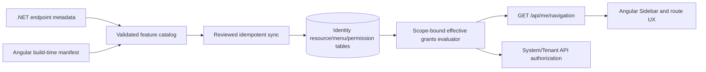

# Feature Registry & Authorization — Foundation

> **Status: Proposed architecture / FR-00 implementation under review (2026-11-07).**
> This document is a handoff and phased implementation plan. It is **not** proof of a working auto-registration system. Do not enable new permission gates or deploy a grant migration based solely on this design.

## Objective and non-goals

Move from manually coordinated Angular routes, System menus, resource records, permission assignments and Minimal API endpoints to an auditable development workflow: **declare capability in code → discover/validate → reconcile catalog without granting access → explicitly assign grants → serve user-scoped navigation → enforce authorization on the API**.

Reuse the current `Modules.System.Identity` EF Core schema and authorization implementations. Do **not** introduce a second RBAC database, make arbitrary Angular components loadable from the database, or interpret a visible menu as an authorization decision. System/tenant isolation and current BFF release gates are out of scope for FR-00.

## Inspected source inventory (main, 2026-11-07)

| Existing responsibility | Actual source |
| --- | --- |
| Modules / resources | `Domain/Entities/Module.cs`, `Resource.cs` |
| API registry and metadata | `ApiResource.cs`, `PermissionApiResource.cs` |
| UI registry | `UiResource.cs`, `PermissionUiResource.cs` (PAGE/ACTION/FIELD/WIDGET) |
| Permission / assignment | `Permission.cs`, `RolePermission.cs`, `UserPermission.cs`, `Role.cs` |
| Menu categories and navigation | `Menu.cs`, `MenuCategory.cs`, `Application/Features/Menus/Queries/GetUserMenus.cs` |
| Current API discovery | `Application/Features/ApiResources/Services/ApiResourceSyncService.cs` |
| Modern platform and tenant gates | `Web/Util/SystemPermissionRequirement.cs`, `TenantPermissionRequirement.cs` |
| Legacy route-derived resolver | `Web/Middlewares/PermissionMiddleware.cs`, `Web/Util/RoutePermissionResolver.cs` |
| Angular dynamic + fallback sidebar | Frontend `src/app/shared/layouts/dashboard-layout/common/sidebar/` |
| Angular administration | Frontend `features/system/menu-management/`, `features/system/resources/`, `features/system/role/` |

**Current facts:**
- `ApiResourceSyncService.SyncMinimalApiResourcesAsync(resourceId)` detects tagged `RouteEndpoint` instances, generates a key from URL+verb, adds missing API resources, and deprecates missing auto-generated ones. It does **not** create Permissions, PermissionApiResource links or UI resources, and only syncs one selected Resource.
- `PermissionMiddleware` is commented out in `DependencyInjections.UseIdentityModule`; it skips endpoints with `IAuthorizeData` when enabled. Do **not** turn it on to achieve granular authorization.
- `RequireSystemPermission` / `RequireTenantPermission` use stable Resource.Action permission **Code** with live DB checks. Some System granular policies remain behind explicit deployment flags. `PlatformPermissionCatalogSeeder` adds definitions without granting anything in Production.
- `GetUserMenus` accepts a caller-supplied role ID; this does not represent the complete user's scoped roles, groups and deny overrides. The `Menus` endpoint group currently also requires `SystemAdministrator`, so it is not a ready tenant navigation API.
- The Angular Sidebar currently falls back to hardcoded System links after an empty/failed menu response and adds more System links manually; these links are navigation only. The template renders one explicit child level.
- `MenuUpdateCommandHandler` was incorrectly reading `Users` and using mismatched `PMenuId` / `Url` names; FR-00 corrects the write path to `Menu` with `ParentId`, `Route` and `ExternalUrl`. Read DTO aliases remain an audited follow-up.
- `RolePermission` is **tenant-scoped** and master-scoped platform grant storage is not a tenant user's context. `IdentityPrincipalFactory` scopes role/group grants, but emits Permission.Name as a claim; the modern requirements use Permission.Code. Resolve this contract before claiming a unified evaluator.
- Existing `RolePermissionsTree` builds under Module→Resource; platform definitions with null ResourceId are absent from that tree. Catalog presentation needs explicit handling.
- `DefaultSeedData` contains historical routes and repeated UI keys. Do not infer that all static definitions were seeded into a deployed database; inspect live data and the actual seeder paths first.

## Proposed ownership and contracts

**Code-owned immutable identities:** `Module.Code`, `Resource.Code` scoped to module, stable `Permission.Code` (`RESOURCE.ACTION`, case normalization defined), `ApiResource.Key` and `UiResource.Key`. Changing route templates, localized titles, icons or component names must not silently redefine permissions. Each definition has owner module, source (code/manual), optional deprecation state and version, with a documented explicit key migration process.

**Database-owned assignments and presentation overrides:** RolePermission, UserPermission allow/deny, group-role links, tenant restrictions, menu enablement, order/title/icon and reviewed deployment overrides. Auto-discovery is **not** authorization and never creates/updates role or user grants. Invalid/unknown keys must fail validation, not silently authorize. Existing manual records cannot be overwritten or deleted by sync.

**Navigation:** a route exists in Angular code and can be indexed by a build-time feature manifest. A Menu references a stable feature key/known route plus a permission rule; DB may reorder/hide it but cannot inject arbitrary components. A direct route guard is UX-only. API requirements are authoritative.

**API:** explicitly annotate protected Minimal API endpoints with named resource/action permission metadata (or well-defined coarse policy). The security evaluator reads authorization metadata, not a derived URL. Discovery reads the same metadata for inventory, reports unbound routes and rejects duplicate keys. Keep System and Tenant scope requirements distinct. PermitAnonymous/health/OIDC/BFF endpoints require explicit documented classification, not an accidental default.

Proposed example (API surface **not implemented**):
```csharp
group.MapGet(GetUsers, "pagedList")
     .RequireSystemPermission("users", "read");
// Registry would inspect the permission metadata during reconciliation;
// no automatic role grant is made.
```

Proposed frontend manifest entry (build/deploy artifact, **not implemented**):
```ts
{
  key: 'system.users.list',
  path: '/system/users',
  uiType: 'PAGE',
  permission: 'USERS.READ',
  navigation: { parentKey: 'system.identity', title: 'کاربران', icon: 'group', order: 20 }
}
```

## Target behavior and boundaries



The catalog must be **fail-closed in CI** (duplicate/unknown keys; unexplained protected endpoints; missing feature routes). Production reconciliation is a reviewed deployment operation with a dry-run diff, safe transaction, audit trail, no implicit role grants, and no automatic deletions. Deprecated definitions are retained until an explicit migration retires grants/links. If metadata changes or an entire module disappears, flag review rather than auto-revoking roles.

The effective permission evaluator must derive `sub`, account type, verified tenant/master scope and active assignments **from the authenticated principal and live authoritative state**, never from a client-submitted role/tenant ID. Include active module/resource/permission state, direct denies overriding grants, all scoped user roles and group roles, tenant restrictions, and active account/membership checks. Deny cross-system/tenant leakage. Missing or disabled permissions deny access. Return 401 for unauthenticated and 403 for authenticated-but-denied operations.

`GET /api/me/navigation` is a proposed authenticated, context-bound endpoint, not an existing API contract. It will filter menu categories and descendants using the exact evaluated grants, and emit only allowed registered routes. A menu parent can be retained as a non-clickable container when an allowed child exists; a hidden/disabled category must not leak children. Frontend should render recursively with a no-access/empty state; **never** replace API failures with hardcoded privileged menu links.

Maintain full BFF rollout isolation: no Angular Password Grant/localStorage/interceptor migration, no BFF enablement, no cookie/CSRF policy relaxation in feature-registry slices. Later BFF navigation requests must use the authenticated same-origin session and not leak bearer tokens into Angular.

## Implementation slices and acceptance gates

| Slice | Changes | Minimum acceptance |
| --- | --- | --- |
| **FR-00 (this PR)** | Freeze inventory/plan; repair menu update command with Angular-aligned field names; regression tests | Update actually modifies Menu, not User; missing ID rejected; no RBAC or BFF side effects |
| **FR-01** | Inventory persisted data; normalize Permission.Code vs Name and read/write Menu DTO contracts; add stable identifiers, unique constraints and migration dry-run | Backward-compatible upgrade plan with no lost grants, duplicate/orphan records enumerated |
| **FR-02** | Endpoint definitions & discovery; support multiple HTTP methods; explicit metadata; deprecated reporting | Unique stable API keys, protected endpoint coverage CI, idempotent safe sync, no grants |
| **FR-03** | Angular feature/route manifest and UI resources; build validation | Angular route ↔ manifest consistency, no arbitrary DB-only routes |
| **FR-04** | One effective scoped permission calculator and navigation API; replace roleId-based navigation query | System/Tenant integration tests, multi-role/group deny precedence, scope isolation and 401/403 |
| **FR-05** | Remove hardcoded Sidebar privileged fallbacks, recursive UI; guard/action directives; admin sync dashboard | Empty/error states safe; hide/show UX matches backend; no unguarded API |
| **FR-06** | Deployment audit, change logs, rollback and E2E | SQL Server + real browser tests, re-login/revocation/tenant boundary acceptance |

### FR-00 review limits

This first slice does not alter any runtime authorization, seeding, migrations, production data, menu navigation response, role selection or BFF feature flags. New menu command field names match the current Angular `MenuCreateCommand` payload; consumers of historical `PMenuId`/`Url` need the documented API contract migration. Parent/category consistency and cycle protection require later Menu tree integrity tests. Validation of the new command is separate from direct handler tests.

## Next exact tasks

1. Inspect deployed identity catalog and actual seeder effects before designing a migration. Audit unique keys, orphan links, stale route values and nullable permissions.
2. Consolidate menu Create/Update/GetById/PagedList DTO property names with frontend types; add compatibility tests and cycle/category/permission validation.
3. Decide and test whether Permission.Code is the sole stable authorization key, then update principal and navigation projection consistently without changing grants.
4. Implement a typed endpoint permission inventory and CI check in an opt-in slice before adding any new enforcement.
5. Build one System Users vertical slice (read/create/update/delete) end-to-end after security and data gates pass.

All slices update `docs/PROJECT-STATE.md`, this architecture record, the relevant module notes and API contracts in the same PR. A passing build alone is not evidence of production tenant/security correctness.


## FR-01A implementation handoff (2026-11-07)

This slice adds a read-only SQL catalog inventory and consistent **read** Menu JSON fields with transitional aliases. It does not change permission policy evaluation, grant storage, deployed database state or Sidebar behavior. See [FR-01A catalog and Menu contract](../development/FR-01A-IDENTITY-CATALOG-AND-MENU-CONTRACT.md) for the actual seeder evidence, SQL procedure and remaining gaps. FR-01B covers normalizing permission claim contracts and validating menu tree integrity only after a compatibility and persisted-data review.


## FR-01B partial implementation (2026-11-07)

The two existing live System/Tenant Resource.Action handlers delegate to one scoped DB-backed `EffectivePermissionEvaluator`. The Identity token continues emitting legacy Name labels and adds deny-filtered `permission_code` values as **snapshots only**. No current-user navigation endpoint exists yet, and menu filtering must later use live grants rather than the JWT or a caller-submitted role. See [FR-01B handoff](../development/FR-01B-PERMISSION-EVALUATOR.md).


## FR-04A implementation (2026-11-07)

A new authenticated current-user navigation GET exists separately from SystemAdministrator Menu administration. It uses live scoped role/group/direct grants and explicit deny, strict menu ancestry and temporary route namespace boundaries; it does not grant API access or auto-seed a catalog. See [FR-04A HTTP contract](current-user-navigation.md). TenantPermissionRestriction semantics and explicit Menu.Scope remain open gates.


## FR-02A delivered vertical design and rollout gate (2026-11-07)

Code-owned Roles/Permissions feature declarations and explicit endpoint metadata now have a read-only admin preview + explicitly gated additive Apply in the first vertical. This creates missing Module/Resource/Permission/UiResource/ApiResource/metadata links and permission-bound default menus without auto grants, deletes or reactivations. The old route-derived sync no longer deprecates missing endpoints. **Do not treat this as arbitrary Angular route discovery or a default-enabled production migration.** See [FR-02A operations](../development/FR-02A-FEATURE-REGISTRY.md).
